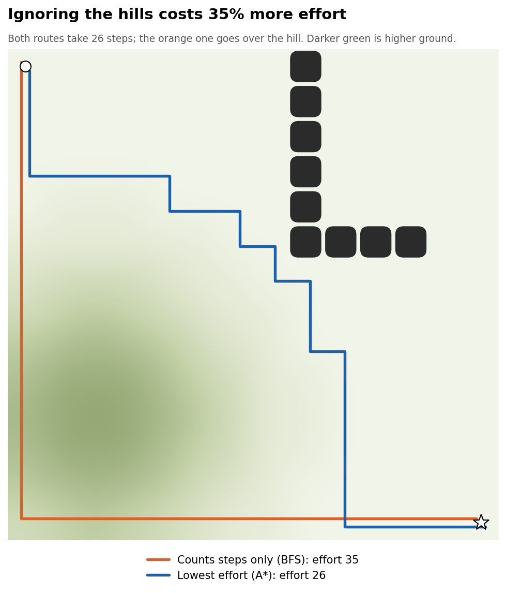
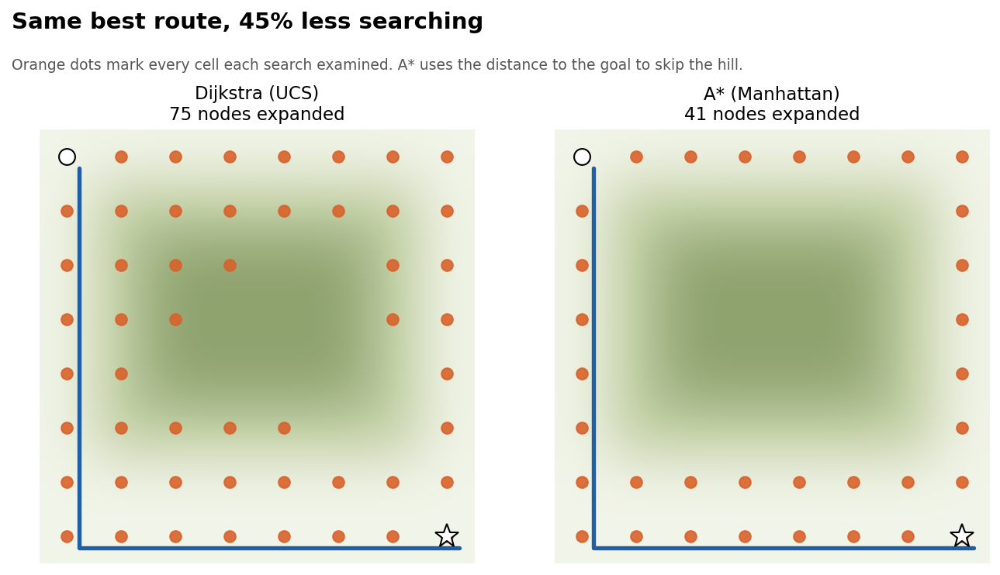
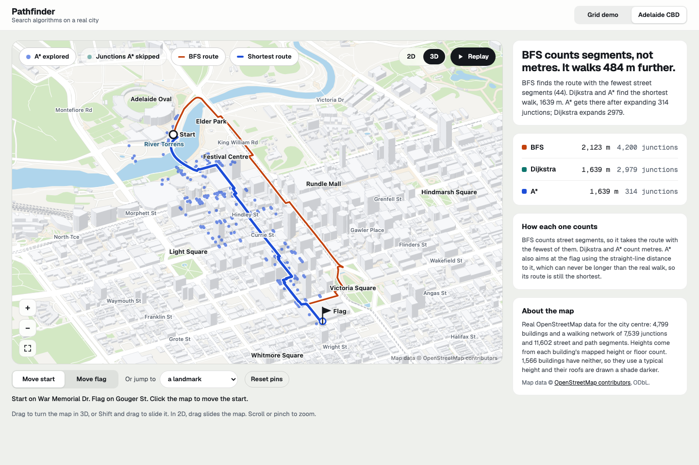

# Pathfinder: Terrain Route Planner


Finds the lowest-effort route across terrain with hills and obstacles, and shows why the
choice of search algorithm matters. BFS, Dijkstra (Uniform Cost Search) and A\* are
implemented from scratch in Python with no external dependencies.

**[Try it in your browser](https://agrim1305.github.io/Pathfinder/)**: BFS, Dijkstra and A\* search the same hilly map, and a timeline lets you scrub through every step. Hover any cell for its real g, h and f. Move the start and the flag, dig or fill the creek, raise or lower the ground, and all three searches run again. The page opens on `maps/detour.txt`, the map behind the figures below, and `python benchmark.py` reproduces them. The browser version is a JavaScript copy of the same algorithms, and CI checks it gives identical results to the Python code on every map. Light and dark themes follow your system, with a toggle in the header.

**The short version:** counting steps is not enough. On the demo map, BFS (which only
counts steps) walks straight over a hill and pays **35% more effort** than the best route of
the same length, and A\* finds that best route while expanding **59% fewer nodes** than Dijkstra.



## The problem

Each cell of the grid has an elevation, and some cells are blocked. Moving to a
neighbouring cell (up, down, left or right) costs:

```
cost = 1 + max(0, elevation_to - elevation_from)
```

So walking downhill or on the flat costs 1, and climbing costs extra. The goal is the
route from start to finish with the lowest total cost.

## Results



Reproduce these with `python benchmark.py`. "Nodes" counts every node taken off the
search queue. A\* uses the Manhattan heuristic.

| Map                      | BFS cost | Best cost (UCS and A\*) | BFS nodes | UCS nodes | A\* nodes | A\* saving vs UCS |
| ------------------------ | -------- | ----------------------- | --------- | --------- | --------- | ----------------- |
| small (5×5)              | 8        | 8                       | 27        | 26        | 16        | 38%               |
| choice (8×8)             | 14       | 14                      | 112       | 75        | 41        | 45%               |
| maze (11×11)             | 20       | 20                      | 96        | 96        | 90        | 6%                |
| open (10×10)             | 18       | 18                      | 180       | 180       | 180       | 0%                |
| large (20×20)            | 67       | 54                      | 618       | 618       | 553       | 11%               |
| detour (14×14), demo map | 35       | 26                      | 331       | 331       | 137       | 59%               |

What the numbers show:

- **BFS ignores cost.** It only counts steps, so on the large map it picks a 38-step route
  that costs 67, when another 38-step route costs 54.
- **A\* only helps when the heuristic has something to say.** It saves 45% on `choice`,
  where the goal direction is clear, and nothing on a flat open grid, where every route
  of the same length ties.
- **UCS and A\* always agree on the best cost**, which the tests check on every map.

## Real city: Adelaide CBD

**[Open the Adelaide demo](https://agrim1305.github.io/Pathfinder/adelaide/)**



BFS, Dijkstra and A\* also run on the real walking network of Adelaide's city centre: 7,539
junctions and 11,602 street and path segments from OpenStreetMap, with 4,799 buildings
drawn in 2D or 3D. Click the map to move the start or the flag, and all three searches run again.

- Tests check all three against NetworkX on 300 random walks. Dijkstra and A\* match the
  shortest distance exactly, and BFS matches the fewest-segment count. Across those walks
  A\* expands a median of 23% as many junctions as Dijkstra.
- A regression test covers a real bug. Edge lengths were measured on unrounded points while
  the A\* heuristic used rounded ones, so the straight-line estimate could exceed an edge by
  up to 0.7 m. That broke consistency and returned routes up to 0.4 m too long. Lengths are
  now measured on the stored points.
- To rebuild the data, install the tools' requirements (Shapely and NetworkX), then download
  and prepare it. [ARCHITECTURE.md](ARCHITECTURE.md) explains each step.

  ```bash
  pip install -r tools/requirements.txt
  python tools/fetch_adelaide.py && python tools/prep_adelaide.py
  ```

- To run it locally, serve `docs/` and open http://localhost:8000/adelaide/. The page loads
  its data over HTTP, so opening the file directly doesn't work.

  ```bash
  cd docs && python -m http.server 8000
  ```

Map data © OpenStreetMap contributors, ODbL.

## Quick start

Requires Python 3.10 or newer. No packages to install.

```bash
# Lowest-cost route with A*
python pathfinder.py release maps/choice.txt astar manhattan

# Same map with Dijkstra (UCS), and with BFS for comparison
python pathfinder.py release maps/choice.txt ucs
python pathfinder.py release maps/choice.txt bfs

# Debug mode: the route plus how often, and in what order, each cell was visited
python pathfinder.py debug maps/large.txt astar manhattan

# Compare all algorithms on all maps
python benchmark.py

# Redraw the README images (optional, needs matplotlib)
pip install matplotlib
python visualize.py
```

## Tests

```bash
python -m unittest discover -s tests -v
for t in tests/compare_js.js tests/test_*.js; do node "$t"; done
```

13 Python tests for the grid search, 7 that check the Adelaide searches against NetworkX,
and Node checks for the browser code: `compare_js.js` (the demo matches the Python code),
`test_trace.js` (recording a trace never changes a search), `test_layers.js` (the numbers on
the page, such as the cells A\* skipped), `test_terrain.js`, `test_view.js` (the shared map
camera), `test_labels.js` (map labels never overlap each other, a pin or a control),
`test_generate.js` (a seed always gives the same random map, with the pins connected) and
`test_contrast.js` (every text and control colour meets WCAG AA in both themes).
GitHub Actions runs them all on every push. The Adelaide tests need Node and NetworkX
(`pip install -r tools/requirements.txt`) and skip themselves without them; CI installs both
and fails if they skip. The grid tests check that:

- every algorithm returns a legal path (adjacent steps, no obstacles, no repeated cells)
  on every map, with both A\* heuristics
- UCS and A\* find the same optimal cost, and BFS never takes more steps than either
- A\* never expands more nodes than UCS
- the figures in the results table stay correct
- edge cases behave: unreachable goal, start equal to goal, a single-cell grid, and
  uphill versus downhill costs

## Design decisions

- **Binary heap priority queue.** UCS and A\* use `heapq`, so each push and pop is
  O(log n). An insertion counter breaks ties, which keeps the order stable and avoids
  comparing positions.
- **Hash-set closed list.** Checking whether a node was already expanded is O(1).
- **Parent pointers, not path copies.** Each node stores the single node it came from,
  and the route is rebuilt once at the goal. An earlier version copied the whole partial
  path into every queue entry, which costs O(path length) memory per entry. Parent
  pointers keep it at O(V) overall, with identical output.
- **Admissible heuristics.** Every step costs at least 1, so Manhattan distance never
  overestimates the remaining cost, and A\* stays optimal. Euclidean is also provided.

## Map format

```
# lines starting with # are comments
rows cols
start_row start_col    (1-indexed)
end_row end_col        (1-indexed)
elevation grid, space-separated, X for an obstacle
```

`generate_maps.py` rebuilds the bundled maps, and its parameters can be changed to make
new ones.

## Project structure

```
pathfinder.py        search algorithms, cost model and command-line interface
benchmark.py         compares every algorithm on every map
visualize.py         draws the README images (needs matplotlib)
docs/                browser demo (index.html, pathfinder.js) and README images
docs/adelaide/       Adelaide CBD demo: graph.js (searches), map.js (2D and 3D map), data
example.py           using the module from Python
generate_maps.py     builds the test maps
maps/                six maps, from a 5×5 demo to a 20×20 random terrain, plus the browser demo map
tests/               unit tests, the browser check and the NetworkX check
tools/               downloads and prepares the Adelaide OpenStreetMap data
ARCHITECTURE.md      how the pieces fit together
```

## Author

Agrim Sharma. Started as a university AI assignment, then extended with benchmarking,
tests and a more memory-efficient path reconstruction.
